# NYC Solar Studio

Explore rooftop solar designs on NYC's 3D buildings. Select a building on an aerial map, mark rooftop equipment with AI assistance, generate a panel layout, and estimate annual energy production with shading from surrounding buildings. The app is a static website hosted on GitHub Pages, with no application server or API keys required.

**[Live demo](https://bokaihe.github.io/nyc-solar-studio/) · [Features](#features) · [Data sources](#data-sources) · [Methods](#methods) · [Run locally](#run-locally) · [Limitations](#limitations)**

[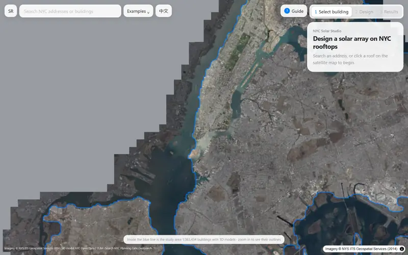](docs/demo.mp4)

> Demo: search for P.S. 321 in Brooklyn → open its LoD2 roof → enable aerial imagery and plan view → detect keep-out areas with U-Net → generate an array → explore winter afternoon shadows → inspect per-panel annual yield → view results. Click the animation for the 60 fps video.

> [!NOTE]
> Results support concept design, option comparison, and early discussions. They do not replace a site survey, structural assessment, or construction design. The building models and imagery represent conditions around 2014; buildings may have changed since then.

## Features

- **Map-based building selection:** browse New York State's 2014 orthoimagery and approximately 1.08 million building outlines. Search by address or click a building; nearby street clicks can snap to a building within 25 m.
- **3D roof geometry:** NYC / TUM LoD2 CityGML models preserve roof planes, slopes, multiple levels, and walls. Nearby buildings within 200 m are loaded for shading analysis.
- **Keep-out areas:** trace equipment, bulkheads, access hatches, or walkways with a pen-style tool, or use the browser's U-Net model to suggest obstacle areas. Edit their vertices, delete individual areas from the list, and use plan view to trace against the imagery. Moving, rotating, or changing panel orientation checks the resulting placement against these areas.
- **Automatic panel layout:** respect keep-out areas, setbacks, walls, and shading filters. Flat roofs use tilted racks; pitched roofs use flush-mounted panels. Untouched generated arrays update when layout settings change.
- **Sun position and shadows:** choose a date and time or animate the sun through the day.
- **Annual energy estimates:** estimate each panel's output using New York typical-year weather, including building, row-to-row, and surrounding-building shading. Color panels by annual yield.
- **Layout search:** compare 42 combinations of rack tilt and row spacing, rank by total energy or a balance of total energy and per-panel performance, and apply a result.
- **Comparison and sharing:** compare A/B designs, recover a local browser draft, and share a layout by URL.
- **Guided tour:** follow the P.S. 321 example on a first visit or reopen it with the help button.
- **English and Chinese interface.**

## Screenshots

| | |
|---|---|
| [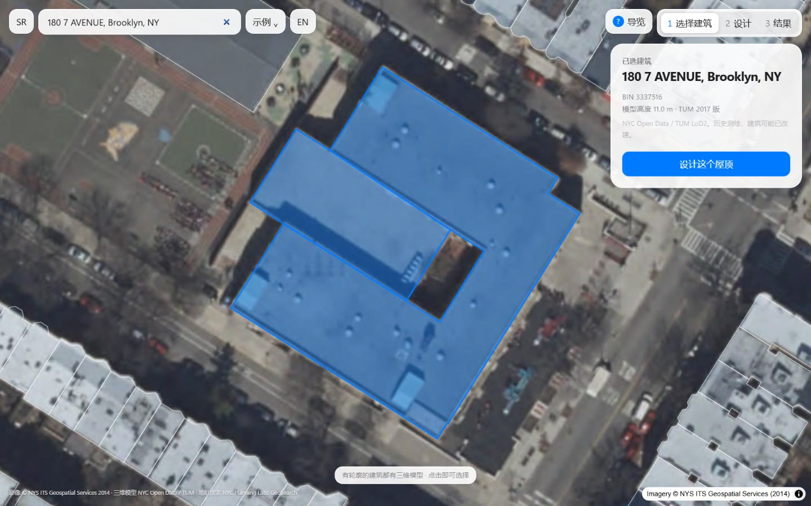](docs/screenshots/readme-map.jpg)<br>**Select a building:** search or click on 2014 aerial imagery; the selected outline appears in blue. | [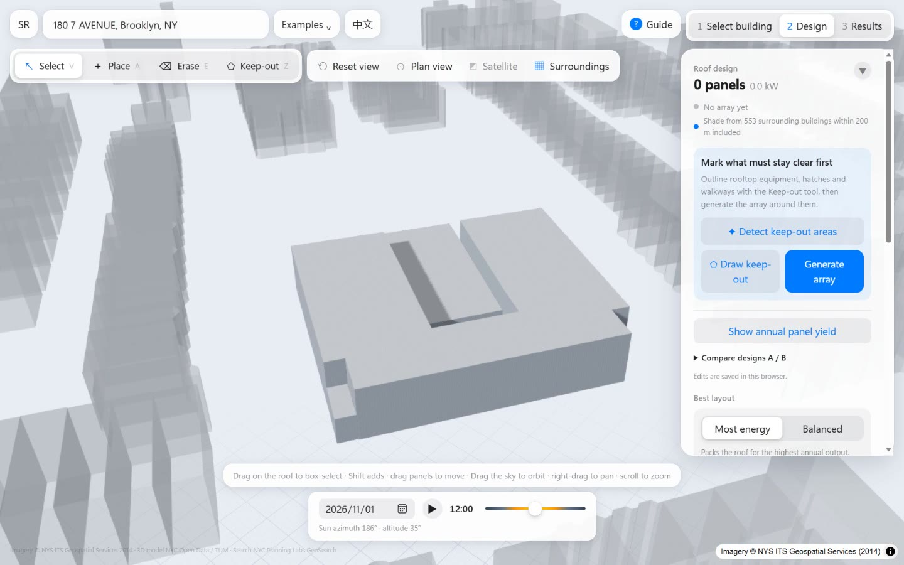](docs/screenshots/readme-model.jpg)<br>**LoD2 roof:** the selected building and translucent surrounding buildings within 200 m. |
| [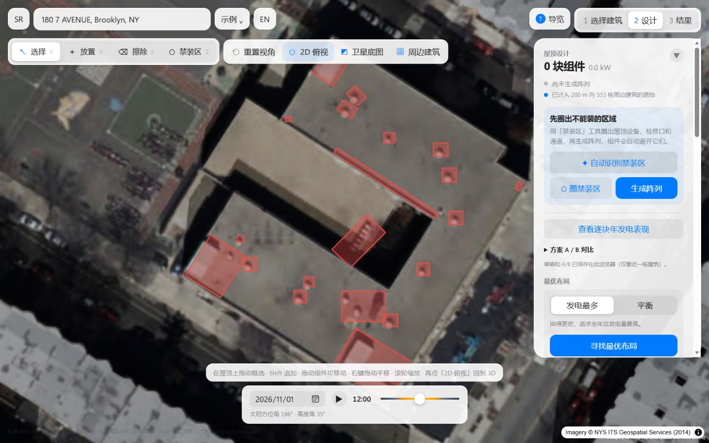](docs/screenshots/readme-zones.jpg)<br>**Obstacle detection:** plan view with aerial imagery; red areas mark equipment and bulkheads detected by U-Net. | [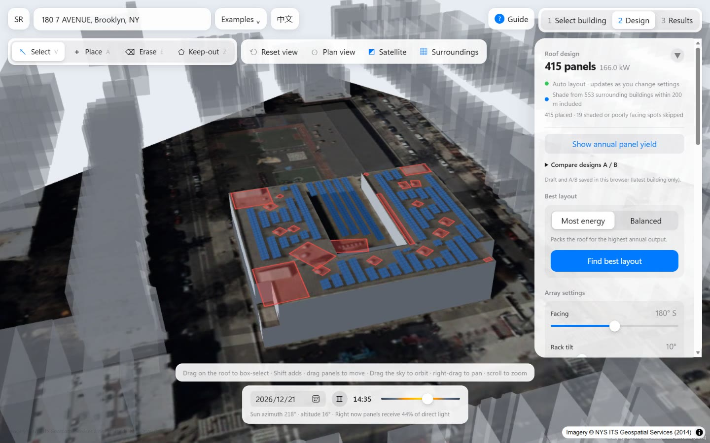](docs/screenshots/readme-shadows.jpg)<br>**Array and shadows:** 415 panels with long shadows from nearby buildings on a winter afternoon. |
| [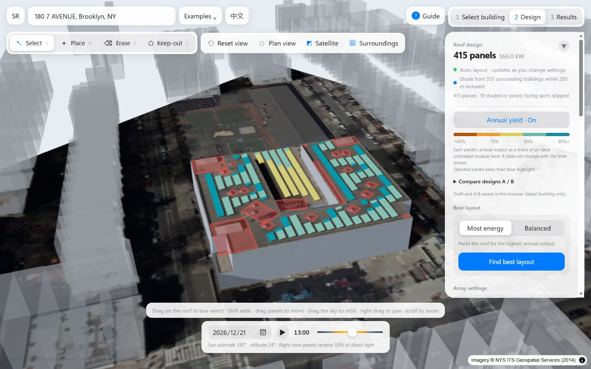](docs/screenshots/readme-yield.jpg)<br>**Annual yield:** colors show output relative to an ideal unshaded module; panels near bulkheads and parapets tend to perform less well. | [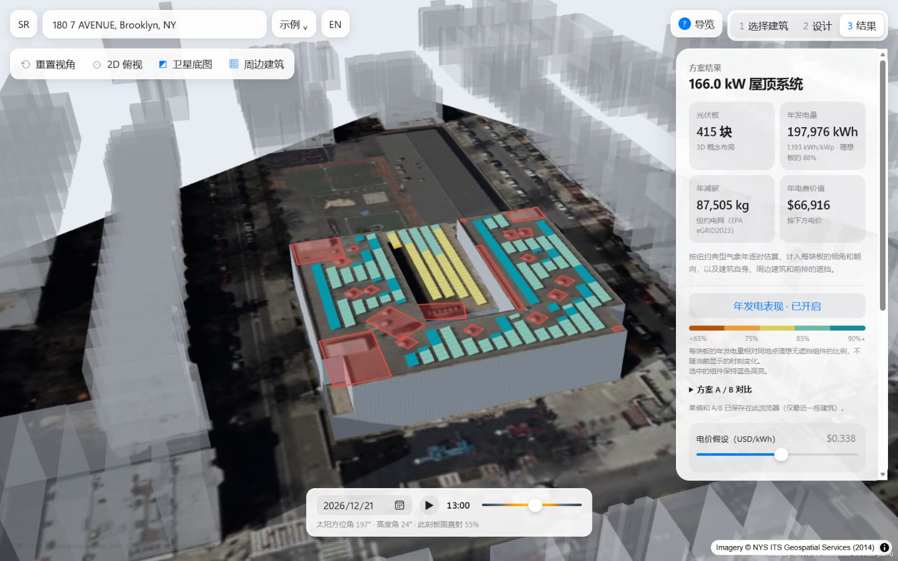](docs/screenshots/readme-results.jpg)<br>**Results:** capacity, annual energy, estimated avoided emissions, and electricity value, with calculation assumptions. |

## Workflow

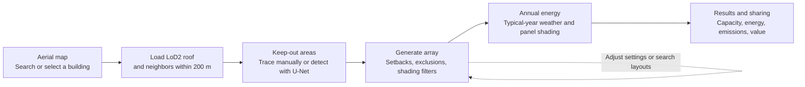

All design calculations run in the browser. Building data is stored as static tiles in the repository, imagery and address search use public services that require no API key, and the AI model is distributed as an ONNX file.

## Data sources

| Data | Provider | Year | Use in the project |
|---|---|---|---|
| [NYC LoD2 building models (CityGML)](https://www.asg.ed.tum.de/gis/projekte/new-york-city-3d/) | NYC DoITT 3D Building Model, converted to LoD2 CityGML by the Technical University of Munich (TUM) | 2014 survey; 2017 release | Roof, wall, and ground geometry; map outlines; surrounding-building shading |
| [New York State orthoimagery](https://orthos.its.ny.gov/arcgis/rest/services/wms) | NYS ITS Geospatial Services | 2014 in the app; 2014/2016/2018 for training | Map and 3D imagery; obstacle detection input |
| [2017 NYC topobathymetric LiDAR](https://noaa-nos-coastal-lidar-pds.s3.amazonaws.com/laz/geoid18/9306/index.html) | NYC / NOAA Office for Coastal Management | 2017 | Offline training-label generation only; not needed at runtime |
| [NYC GeoSearch](https://geosearch.planninglabs.nyc/) | NYC Planning Labs | Live service | Address search |
| [PVGIS-ERA5 typical meteorological year](https://joint-research-centre.ec.europa.eu/photovoltaic-geographical-information-system-pvgis_en) | European Commission Joint Research Centre (JRC) | 2005–2023 | Monthly/hourly irradiance and temperature profiles in `src/lib/solar/nyc-climate.ts` |
| [eGRID2023](https://www.epa.gov/egrid) | US Environmental Protection Agency (EPA) | 2023 | NYCW grid emissions factor: 974.66 lb/MWh, approximately 442 kg CO₂/MWh |
| [RECS 2020](https://www.eia.gov/consumption/residential/) | US Energy Information Administration (EIA) | 2020 | Refrigerator electricity use of 542 kWh/year for a results-page equivalence |
| ImageNet pretrained weights | segmentation_models_pytorch / timm | — | U-Net encoder initialization |

**Defaults:** 1.045 × 1.879 m, 400 W modules; south-facing racks at 10°; 1.2 m edge setback; 0.8 m row gap; electricity value of USD 0.338/kWh. The rate is editable and should be checked against the actual electricity tariff.

## Methods

### 1. Building models and static tiles

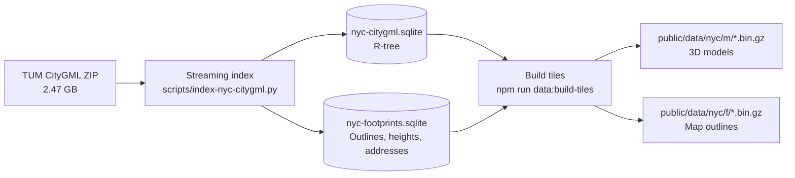

CityGML RoofSurface, WallSurface, and GroundSurface geometry is retained, transformed from EPSG:32118 state-plane coordinates into scene coordinates, and triangulated. Original GML identifiers, NYC BINs, and heights are preserved.

Approximately 1.08 million buildings are grouped into a 0.003° × 0.0025° grid, roughly 250 m per cell, and compressed into about 350 MB of tiles. Model vertices are stored as integer offsets from a building's minimum coordinates, with centimeter-based quantization. Outlines use delta-encoded longitude/latitude integers at a scale of 10⁷. The binary format is defined in `src/lib/nyc/tile-format.ts`.

The browser downloads nearby tiles and decompresses them with `DecompressionStream`. It checks the clicked point against footprints within one grid cell in each direction, then uses a nearby-building fallback within 25 m when needed. Neighbor lookup spans two cells in each direction and filters buildings within 200 m. A distance-dependent height filter keeps potential obstructions above a 3° horizon angle.

### 2. Sun position and shading

- **Sun position:** computed with SunCalc.
- **Annual sampling:** hourly solar positions on the 21st of each month, retaining sunlit samples with nonzero irradiance and weighting them using the PVGIS typical year.
- **Visibility:** rays from panel centers toward the sun test the building's roof, walls, and surrounding buildings. Triangle tests use a bounding volume hierarchy (BVH); visibility is cached on a 1.5 m grid.
- **Performance:** layout generation runs in a Web Worker, while incremental energy calculations and instanced rendering reduce editing costs. Recorded tests on an approximately 11,000-panel roof measured about 0.1 seconds of work after an edit; see `docs/ACCEPTANCE.md` for the test conditions.

### 3. Automatic layout

Each planar roof face is processed separately:

1. Build a 0.2 m raster in the roof's local plane and apply setbacks using a distance transform. Triangulated keep-out outlines are matched using local heights with a 2 m tolerance, then excluded with the same setback.
2. Align rows to the building axis and evaluate 36 grid offsets to find the arrangement with the most panels.
3. Score candidates for annual energy performance and, unless shaded locations are enabled, discard positions below 80% of the best candidate's score.
4. Roofs below 8° slope use tilted racks and row gaps. Steeper roofs receive flush-mounted panels.
5. Check candidate panels against walls, higher roof parts, neighboring buildings, and panel overlap. Manual placement also applies clearance checks. Drag completion, rotation, and orientation changes reject an entire selected group if any resulting panel overlaps a keep-out area.

### 4. Energy model

For each module, representative monthly/hourly samples estimate:

- **Plane-of-array irradiance:** shaded direct irradiance, isotropic diffuse irradiance weighted by visible sky, and ground reflection with albedo 0.2.
- **Losses:** ASHRAE incidence-angle losses, cell-temperature correction, 14% system losses, and 96% inverter efficiency.
- **Reference output:** the project's unshaded, optimally tilted reference is approximately 1,360 kWh/kWp. The results page also shows an approximate PVWatts comparison range. This comparison is a modeling assumption, not a separate PVWatts calculation for the edited layout.

### 5. Layout search

The optimizer evaluates seven rack tilts from 0° to 30° and six row gaps from 0.3 to 2 m: 42 combinations, with other settings fixed. Solar and sky visibility are reused across candidates. Recorded testing on a Midtown podium reduced search time from 92 seconds to about 13 seconds.

Two objectives are available: maximize total annual energy, or maximize energy among options whose per-panel performance reaches at least 90% of the ideal reference. The top three options can be applied directly.

### 6. Rooftop obstacle detection with U-Net

LoD2 models omit many small rooftop objects. A compact U-Net detects them in aerial imagery. **Training labels are generated automatically from 2017 LiDAR**; the deployed application only needs imagery for inference.

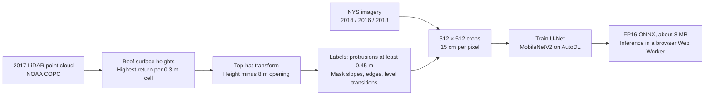

**Label generation** (`ml/nyc_roofs.py`): within each building footprint, the highest LiDAR return in each 0.3 m cell defines a surface-height raster. An 8 m morphological opening estimates the underlying roof by removing smaller protrusions. Subtracting this estimate identifies objects at least 0.45 m high, such as equipment, bulkheads, tanks, and vents.

Training ignores pitched roofs, the 0.6 m strip around roof edges, transitions between roof levels, and connected raised regions larger than 45 m², which often represent a higher roof level.

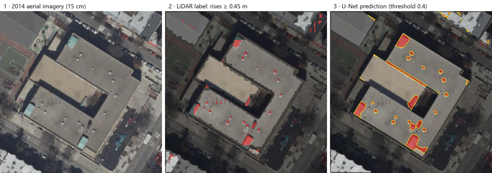

<sub>P.S. 321: 2014 imagery on the left; LiDAR-derived labels in the middle (red obstacles, dark ignored regions); U-Net predictions on the right. This example detects three bulkheads and multiple vents. A long shadow at a roof-level transition produces a false positive.</sub>

**Dataset** (`ml/build_dataset.py`): 60 randomly sampled LiDAR tiles, each approximately 770 m across, produce 1,168 crops of 512 × 512 pixels. Each crop has imagery from 2014, 2016, and 2018. Training, validation, and test splits are grouped by LiDAR tile, with 993 / 86 / 89 crops. P.S. 321 is assigned to the test split.

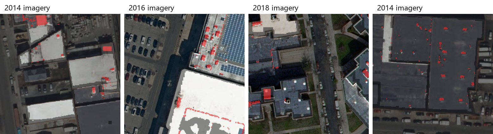

<sub>Training examples: red indicates LiDAR-derived obstacles; dark areas are excluded from training. Imagery from three years shares the same labels to expose the model to varying seasons and lighting.</sub>

**Training** (`ml/train/`): the recorded run used an RTX 4090D on AutoDL for 60 epochs, taking about seven minutes.

- U-Net with an ImageNet-pretrained MobileNetV2 encoder and a reduced decoder; the FP16 ONNX export is approximately 8 MB.
- Binary cross-entropy with positive-class weight 3, plus Dice loss, evaluated only on labeled pixels.
- Augmentation: random 384-pixel crops, rotations, flips, brightness, contrast, hue, and gamma changes.
- AdamW optimizer with warmup and cosine learning-rate decay.

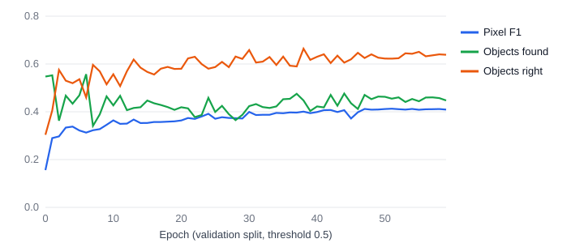

**Reported evaluation results**, using threshold 0.4 selected on the validation split:

| Split | Pixel F1 | Pixel IoU | Object recall | Object precision | Obstacles |
|---|---|---|---|---|---|
| Validation | 0.41 | 0.26 | 0.49 | 0.61 | 1,671 |
| Test | 0.43 | 0.28 | 0.49 | 0.60 | 1,425 |

Object recall measures the fraction of LiDAR-labeled objects of at least 0.3 m² overlapped by a prediction. Object precision measures the fraction of predicted regions that overlap a labeled obstacle. These metrics use automatically generated labels: small vents may be difficult to see in imagery, while flat skylights can be absent from height-based labels. The results still require manual review; label limitations do not establish a higher real-world accuracy.

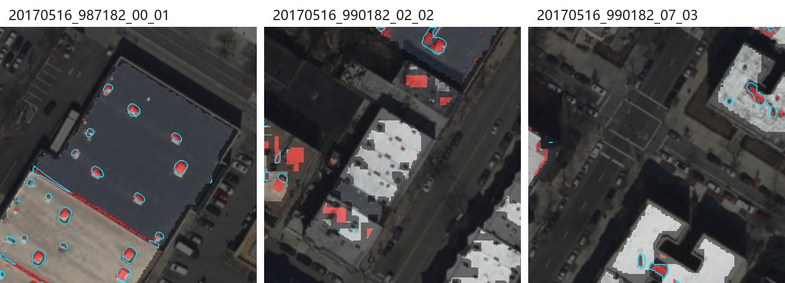

<sub>Held-out test neighborhoods: red shows LiDAR-derived obstacles; cyan outlines show model predictions.</sub>

The label-generation and training code, learning curves, threshold sweep, and predictions on three buildings are collected in [`ml/unet-results.ipynb`](ml/unet-results.ipynb), which can be viewed on GitHub.

**Browser inference** (`src/lib/design/obstacle.worker.ts`, `detect-obstacles.ts`):

1. Load ONNX Runtime Web's WebAssembly runtime, approximately 15 MB, and the model when the user first requests detection.
2. Crop the building's flat roofs from the scene imagery, resample toward 15 cm per pixel, and process overlapping 512-pixel tiles in a Web Worker.
3. Threshold probabilities at 0.4, apply morphological cleanup, group connected components, and fit minimum-area rectangles. Expand them by 0.15 m to create keep-out areas.
4. The recorded example took approximately three seconds on first detection. If model loading fails, a color-anomaly fallback uses the roof's median color and median absolute deviation (MAD).

### 7. Results

- **Installed capacity:** module count × 400 W by default.
- **Annual energy:** sum of per-module estimates from the energy model above.
- **Estimated avoided emissions:** annual energy in MWh × 442 kg CO₂/MWh.
- **Electricity value:** annual energy × the entered electricity rate.

The results panel states whether keep-out areas were deducted, explains that annual output uses typical-year weather independently of the sun-bar date, and lists the comparison range, module specifications, and loss assumptions.

## Technology stack

- **Web app:** Next.js static export, React, TypeScript, Tailwind CSS, MapLibre GL, Three.js / React Three Fiber, SunCalc, Proj4, ONNX Runtime Web, and Vitest.
- **Data preparation:** Node SQLite, fast-xml-parser, and Python with NumPy, SciPy, laspy, pyproj, and Pillow.
- **Model training:** PyTorch, segmentation_models_pytorch, and ONNX.
- **Demo recording:** Playwright and FFmpeg.

## Run locally

Use Node.js 22.13 or later; Node 24 has been tested. Building tiles and the obstacle model are included in the repository.

```bash
npm install
npm run dev
```

Open [localhost:3000](http://localhost:3000/). Both `npm run dev` and `npm run build` first copy ONNX Runtime's WebAssembly assets into `public/ort`.

Run checks:

```bash
npm test
npm run lint
npm run build
```

## Deploy to GitHub Pages

The live application is available at [bokaihe.github.io/nyc-solar-studio](https://bokaihe.github.io/nyc-solar-studio/).

To deploy your own copy:

1. Push the repository to GitHub, including `public/data/nyc` (approximately 350 MB) and `public/models`.
2. In **Settings → Pages**, select **GitHub Actions** as the source. Ensure the `github-pages` environment allows deployment from `main`.
3. Push to `main`, or manually run **Deploy to GitHub Pages** (`.github/workflows/pages.yml`). The workflow sets `NEXT_PUBLIC_BASE_PATH` to the repository path, exports the site to `out/`, and deploys it.

To preview the export locally, run `npm run build` and serve `out/` with a static HTTP server.

## Rebuild data and models

### Building tiles

Download the [official CityGML ZIP](https://www.3dcitydb.net/3dcitydb/fileadmin/public/datasets/NYC/NYC_buildings_CityGML_LoD2/NYC_Buildings_LoD2_CityGML.zip), approximately 2.47 GB, into `data/raw/nyc-tum/`, then run:

```bash
python scripts/index-nyc-citygml.py --archive data/raw/nyc-tum/NYC_Buildings_LoD2_CityGML.zip --output data/processed/nyc-citygml.sqlite --sevenzip node_modules/7zip-bin/win/x64/7za.exe
npm run data:build-footprints
npm run data:build-tiles
```

The indexing command above uses the bundled Windows 7-Zip binary; use your system's compatible 7-Zip path on other platforms.

`data:build-tiles` takes approximately two hours in a single process. It accepts a geographic bounding box (`west,south,east,north`) for partitioned runs and skips existing tiles. After all partitions finish, run it without a bounding box to refresh `index.json`. The blue study-area boundary is generated by `npm run data:build-coverage`.

### Obstacle model

Python 3.10 or later is required. Dataset preparation downloads approximately 4 GB of LiDAR. The following commands use Windows virtual-environment paths:

```bash
python -m venv ml/.venv
ml/.venv/Scripts/python -m pip install numpy scipy "laspy[lazrs]" pyproj pillow
ml/.venv/Scripts/python ml/build_dataset.py --tiles 60 --out data/ml/dataset
ml/.venv/Scripts/python ml/package_autodl.py
```

Upload `data/ml/autodl-package.zip` to a GPU server and follow its `train/README.md` to train, evaluate, and export the model.

- Copy `model.fp16.onnx` to `public/models/roof-obstacles.onnx`.
- Set the inference threshold in `src/lib/design/obstacle-model.ts`.
- Generate figures with `ml/make_figures.py`.
- Use [`ml/unet-results.ipynb`](ml/unet-results.ipynb) to inspect label generation, training code, metrics, and building predictions locally without retraining.

## Record the demo

Install FFmpeg, Microsoft Edge, and Python with Pillow. Start a local copy of the site, preferably a static export, then run:

```bash
npm run demo:record -- http://localhost:8090/solar-3d-web/
npm run readme:screenshots
```

Replace the example URL with the address and base path of your local server.

`demo:record` follows the [storyboard](docs/demo-storyboard.md) using the real interface and captures timestamped Chrome DevTools screencast frames. It produces `docs/demo.mp4` at 60 fps and 1440 × 900 resolution, plus `docs/demo.webp`, a 20 fps, 800-pixel-wide README preview. `readme:screenshots` extracts still images from the recording.

The default recording language is English; set `DEMO_LANG=zh` for Chinese. Raw frames require approximately 1 GB; use `DEMO_TMP` to select their storage directory.

## Limitations

- **Historical data:** building models and imagery represent conditions around 2014. Later construction, demolition, and extensions may not match.
- **Image alignment:** roof displacement in tall-building imagery can shift textures and detected regions by several meters.
- **Shading coverage:** trees, snow, and small rooftop equipment are not modeled as shading geometry. Detected keep-out areas exclude panels but do not cast shadows. The sun animation does not simulate changing weather.
- **Detection requires review:** equipment with roof-like colors or installed after the imagery date may be missed. Shadows at roof-level transitions can produce false positives.
- **Concept-level energy estimates:** electrical string design, inverter selection, roof loading, and code-specific fire-access requirements are not resolved by the app.
- **Illustrative electricity rate:** USD 0.338/kWh is a default assumption. Actual bill savings depend on tariffs, consumption, and export compensation.

## Attribution and acknowledgments

- Building models: NYC Open Data / DoITT 3D Building Model; LoD2 CityGML by the Chair of Geoinformatics, Technical University of Munich.
- Imagery © NYS ITS Geospatial Services. LiDAR: 2017 New York City Topobathymetric LiDAR, NYC / NOAA Office for Coastal Management.
- Address search: NYC Planning Labs GeoSearch. Climate: PVGIS-ERA5 TMY, European Commission JRC. Grid factor: EPA eGRID2023.

Retain these attributions when sharing the project and follow each dataset's terms of use.
