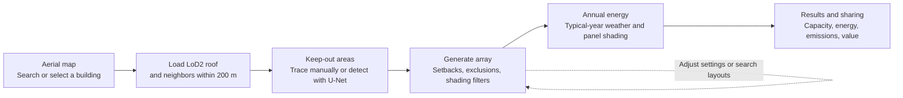

# NYC Solar Studio

Design rooftop solar on NYC buildings with available LoD2 models: pick a building on an aerial map, let a U-Net outline rooftop equipment, generate a panel layout, and estimate annual energy with shading from surrounding buildings. A static site on GitHub Pages; no server or API keys.

**[Live demo](https://bokaihe.github.io/nyc-solar-studio/) · [Features](#features) · [Data](#data-sources) · [Methods](#methods) · [Run locally](#run-locally) · [Limitations](#limitations)**

[](docs/demo.mp4)

<sub>Click the animation to watch the demo.</sub>

> [!NOTE]
> For concept design and option comparison, not a substitute for a site survey or engineering design. Buildings and imagery reflect conditions around 2014.

## Features

- **Building selection** on 2014 aerial imagery with about 1.08 million building outlines; address search.
- **3D LoD2 roofs** with real roof planes, slopes and levels, plus surrounding buildings within 200 m for shading.
- **Keep-out areas** drawn with a pen tool or detected by a U-Net, editable vertex by vertex, with a 2D plan view for tracing.
- **Automatic layout** that respects keep-out areas, setbacks, walls and shading: tilted racks on flat roofs, flush panels on pitched ones.
- **Sun and shadows** for any date and time, with playback through the day.
- **Annual energy** per panel from typical-year weather and modeled building and row shading, with a per-panel yield heatmap.
- **Layout search** over 42 tilt and row-gap combinations.
- **A/B comparison, local drafts, share links, a guided tour,** and an English/Chinese interface.

## Screenshots

| | |
|---|---|
| [](docs/screenshots/readme-map.jpg)<br>**Select a building** | [](docs/screenshots/readme-model.jpg)<br>**LoD2 roof and neighbors** |
| [](docs/screenshots/readme-zones.jpg)<br>**U-Net obstacle detection** | [](docs/screenshots/readme-shadows.jpg)<br>**Array and winter shadows** |
| [](docs/screenshots/readme-yield.jpg)<br>**Per-panel annual yield** | [](docs/screenshots/readme-results.jpg)<br>**Results** |

## Workflow



## Data sources

| Data | Provider | Year | Use |
|---|---|---|---|
| [NYC LoD2 building models (CityGML)](https://www.asg.ed.tum.de/gis/projekte/new-york-city-3d/) | NYC DoITT, converted to LoD2 by TU Munich | 2014 survey, 2017 release | Roof geometry, map outlines, neighbor shading |
| [NYS orthoimagery](https://orthos.its.ny.gov/arcgis/rest/services/wms) | NYS ITS Geospatial Services | 2014 (app); 2014/16/18 (training) | Map and 3D imagery, detection input |
| [2017 NYC topobathymetric LiDAR](https://noaa-nos-coastal-lidar-pds.s3.amazonaws.com/laz/geoid18/9306/index.html) | NYC / NOAA | 2017 | Training labels only |
| [NYC GeoSearch](https://geosearch.planninglabs.nyc/) | NYC Planning Labs | Live | Address search |
| [PVGIS-ERA5 typical year](https://joint-research-centre.ec.europa.eu/photovoltaic-geographical-information-system-pvgis_en) | EU Joint Research Centre | 2005–2023 | Hourly irradiance and temperature |
| [eGRID2023](https://www.epa.gov/egrid) | US EPA | 2023 | NYCW grid factor, about 442 kg CO₂/MWh |
| [RECS 2020](https://www.eia.gov/consumption/residential/) | US EIA | 2020 | Refrigerator equivalence (542 kWh/year) |

**Defaults:** 1.045 × 1.879 m, 400 W modules; south-facing racks at 10°; 1.2 m setback; 0.8 m row gap; USD 0.338/kWh (editable; check your tariff).

## Methods

- **Building geometry:** original NYC / TUM LoD2 roof and wall surfaces, with surrounding buildings within 200 m for shading.
- **Panel layout:** rows follow the building axis and account for setbacks, keep-out areas, clearance and shading. Flat roofs use tilted racks; pitched roofs use flush-mounted panels. Layout search compares 42 tilt and row-gap combinations.
- **Obstacle detection:** a U-Net suggests keep-out areas from aerial imagery. Review and edit these areas before generating panels. Reported test results against automatic LiDAR labels are pixel F1 0.43 and object recall 0.49; detection can miss obstacles or mark clear roof areas.
- **Sun and energy:** the date/time control changes the displayed sun position and shadows. Annual energy uses a typical meteorological year, including modeled building and row shading, temperature effects and system losses; changing the sun-bar date does not change that annual weather basis.
- **Results:** installed capacity follows panel count and wattage; estimated avoided emissions use annual MWh × 442 kg CO₂/MWh; electricity value uses annual kWh × the entered rate. Any PVWatts comparison range is an approximate scaling of this project's estimate, without a separate PVWatts calculation.

## Run locally

Node.js 22.13+. Building tiles and the model are in the repository.

```bash
npm install
npm run dev
```

Open [localhost:3000](http://localhost:3000/) in your browser.

## Limitations

- Buildings and imagery date from around 2014; later changes are missing.
- Tall buildings lean in the imagery, shifting textures and detections by several meters.
- Trees, snow and small equipment do not cast shadows.
- Detection can miss roof-colored or newer equipment and mistake level-transition shadows for obstacles.
- Energy figures are concept-level: no string design, structural or fire-code checks; the electricity rate is a placeholder.

## License and credits

Code and original documentation: [MIT](LICENSE), © 2026 Bokai He. Building data, imagery (including media that show it), model weights and dependencies are excluded; see [third-party notices](THIRD_PARTY_NOTICES.md).

Data: NYC Open Data / DoITT and TU Munich (buildings) · NYS ITS Geospatial Services (imagery) · NYC / NOAA (LiDAR) · NYC Planning Labs (GeoSearch) · EU JRC PVGIS · US EPA eGRID.
