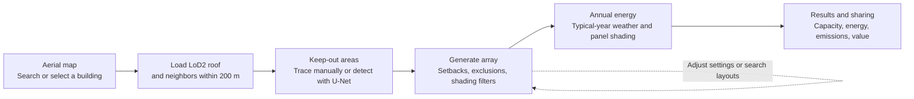
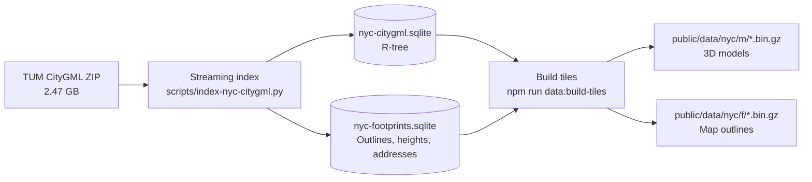
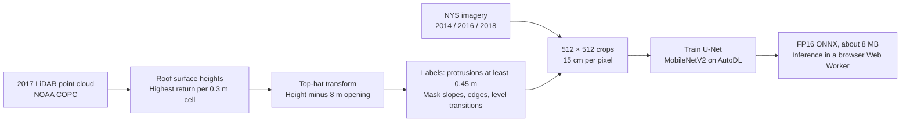

# NYC Solar Studio

Design rooftop solar on NYC buildings with available LoD2 models: pick a building on an aerial map, let a U-Net outline rooftop equipment, generate a panel layout, and estimate annual energy with shading from surrounding buildings. A static site on GitHub Pages; no server or API keys.

**[Live demo](https://bokaihe.github.io/nyc-solar-studio/) · [Features](#features) · [Data](#data-sources) · [Methods](#methods) · [Run locally](#run-locally) · [Limitations](#limitations)**

[](docs/demo.mp4)

<sub>Click the animation for the 60 fps video.</sub>

> [!NOTE]
> For concept design and option comparison, not a substitute for a site survey or engineering design. Buildings and imagery reflect conditions around 2014.

## Features

- **Building selection** on 2014 aerial imagery with about 1.08 million building outlines; address search.
- **3D LoD2 roofs** with real roof planes, slopes and levels, plus surrounding buildings within 200 m for shading.
- **Keep-out areas** drawn with a pen tool or detected by a U-Net, editable vertex by vertex, with a 2D plan view for tracing.
- **Automatic layout** that respects keep-out areas, setbacks, walls and shading: tilted racks on flat roofs, flush panels on pitched ones.
- **Sun and shadows** for any date and time, with playback through the day.
- **Annual energy** per panel from typical-year weather and modeled building and row shading, with a per-panel yield heatmap.
- **Layout search** over 42 tilt and row-gap combinations.
- **A/B comparison, local drafts, share links, a guided tour,** and an English/Chinese interface.

## Screenshots

| | |
|---|---|
| [](docs/screenshots/readme-map.jpg)<br>**Select a building** | [](docs/screenshots/readme-model.jpg)<br>**LoD2 roof and neighbors** |
| [](docs/screenshots/readme-zones.jpg)<br>**U-Net obstacle detection** | [](docs/screenshots/readme-shadows.jpg)<br>**Array and winter shadows** |
| [](docs/screenshots/readme-yield.jpg)<br>**Per-panel annual yield** | [](docs/screenshots/readme-results.jpg)<br>**Results** |

## Workflow



## Data sources

| Data | Provider | Year | Use |
|---|---|---|---|
| [NYC LoD2 building models (CityGML)](https://www.asg.ed.tum.de/gis/projekte/new-york-city-3d/) | NYC DoITT, converted to LoD2 by TU Munich | 2014 survey, 2017 release | Roof geometry, map outlines, neighbor shading |
| [NYS orthoimagery](https://orthos.its.ny.gov/arcgis/rest/services/wms) | NYS ITS Geospatial Services | 2014 (app); 2014/16/18 (training) | Map and 3D imagery, detection input |
| [2017 NYC topobathymetric LiDAR](https://noaa-nos-coastal-lidar-pds.s3.amazonaws.com/laz/geoid18/9306/index.html) | NYC / NOAA | 2017 | Training labels only |
| [NYC GeoSearch](https://geosearch.planninglabs.nyc/) | NYC Planning Labs | Live | Address search |
| [PVGIS-ERA5 typical year](https://joint-research-centre.ec.europa.eu/photovoltaic-geographical-information-system-pvgis_en) | EU Joint Research Centre | 2005–2023 | Hourly irradiance and temperature |
| [eGRID2023](https://www.epa.gov/egrid) | US EPA | 2023 | NYCW grid factor, about 442 kg CO₂/MWh |
| [RECS 2020](https://www.eia.gov/consumption/residential/) | US EIA | 2020 | Refrigerator equivalence (542 kWh/year) |

**Defaults:** 1.045 × 1.879 m, 400 W modules; south-facing racks at 10°; 1.2 m setback; 0.8 m row gap; USD 0.338/kWh (editable; check your tariff).

## Methods

### 1. Building tiles



- Original CityGML roof, wall and ground surfaces, triangulated; GML IDs, BINs and heights kept.
- About 1.08 million buildings in roughly 250 m grid tiles (about 350 MB, gzip, centimeter-quantized; format in `src/lib/nyc/tile-format.ts`).
- The browser downloads only nearby tiles, snaps street clicks to a building within 25 m, and loads neighbors within 200 m that rise above a 3° horizon.

### 2. Shading

- Sun positions (SunCalc) on the 21st of each month, hourly, weighted by the PVGIS typical year.
- Rays from each panel test the roof, walls and neighbors through a BVH; visibility is cached on a 1.5 m grid.
- Layout runs in a Web Worker; a recorded edit on an 11,000-panel roof took about 0.1 s (see [acceptance records](docs/ACCEPTANCE.md)).

### 3. Automatic layout

Per planar roof face:

1. A 0.2 m raster minus setbacks and keep-out areas (matched at local roof height, 2 m tolerance).
2. Rows aligned to the building axis; the best of 36 grid offsets.
3. Positions below 80% of the best annual score are dropped (unless shaded spots are allowed).
4. Tilted racks below 8° slope, flush panels above.
5. Clearance checks against walls, higher roofs, neighbors and other panels. Moves and rotations that would enter a keep-out area are rejected for the whole selection.

### 4. Energy model

- Plane-of-array irradiance: shaded beam, isotropic diffuse scaled by visible sky, ground reflection (albedo 0.2).
- Losses: ASHRAE incidence angle, cell temperature, 14% system losses, 96% inverter efficiency.
- The model's unshaded, optimally tilted reference yields about 1,360 kWh/kWp. The results page shows an approximate PVWatts comparison range derived by scaling this project's estimate; it does not run a separate PVWatts calculation for the layout.

### 5. Layout search

Seven rack tilts (0–30°) × six row gaps (0.3–2 m), with visibility reused across candidates (a Midtown podium: 92 s → 13 s). Rank by total energy, or by total energy among options at ≥ 90% per-panel performance; apply any of the top three.

### 6. Rooftop obstacle detection (U-Net)

LoD2 models omit small rooftop objects, so a compact U-Net finds them in aerial imagery. Training labels come from LiDAR automatically; the site itself needs only imagery.



- **Labels** (`ml/nyc_roofs.py`): per building, roof height minus its 8 m morphological opening; objects rising ≥ 0.45 m are obstacles. Pitched roofs, 0.6 m edges, level transitions and raised areas over 45 m² are ignored.
- **Dataset** (`ml/build_dataset.py`): 60 LiDAR tiles → 1,168 crops with three imagery years, split by tile into 993 / 86 / 89.
- **Training** (`ml/train/`): ImageNet-pretrained MobileNetV2 U-Net, BCE + Dice on labeled pixels, flips, rotations and color jitter, AdamW with cosine decay; 60 epochs in about 7 minutes on an RTX 4090D.


<sub>P.S. 321: imagery, LiDAR labels (red; dark = ignored) and U-Net predictions.</sub>


**Results** at threshold 0.4 (chosen on validation):

| Split | Pixel F1 | Pixel IoU | Object recall | Object precision | Obstacles |
|---|---|---|---|---|---|
| Validation | 0.41 | 0.26 | 0.49 | 0.61 | 1,671 |
| Test | 0.43 | 0.28 | 0.49 | 0.60 | 1,425 |

Labels are automatic: tiny vents are hard to see in imagery, and flat skylights have no height, so detections still need a manual check.


<sub>Held-out neighborhoods: red = LiDAR obstacles, cyan = predictions.</sub>

Code, curves, threshold sweep and predictions on three buildings: [`ml/unet-results.ipynb`](ml/unet-results.ipynb).

**In the browser** (`src/lib/design/obstacle.worker.ts`): on first use, ONNX Runtime Web (about 15 MB) and the model load; the roof is resampled to 15 cm, run in overlapping 512-pixel tiles, thresholded and cleaned, and each region becomes a minimum-area rectangle. First detection took about 3 s in the recorded example. If loading fails, a color-anomaly rule is used instead.

### 7. Results

Capacity = panels × 400 W; annual energy = sum of panel estimates; avoided CO₂ = MWh × 442 kg; value = kWh × rate.

## Tech stack

Next.js (static export), React, TypeScript, Tailwind CSS, MapLibre GL, Three.js / React Three Fiber, SunCalc, Proj4, ONNX Runtime Web, Vitest · Python (NumPy, SciPy, laspy, PyTorch, segmentation_models_pytorch) · Playwright and FFmpeg for the demo.

## Run locally

Node.js 22.13+. Building tiles and the model are in the repository.

```bash
npm install
npm run dev
```

Checks: `npm test`, `npm run lint`, `npm run build`.

**Deploy your own copy:** push to GitHub (including `public/data/nyc`, about 350 MB), set **Settings → Pages → Source** to **GitHub Actions**, and push to `main`; `.github/workflows/pages.yml` builds and deploys.

## Rebuild data and models

**Building tiles:** download the [CityGML ZIP](https://www.3dcitydb.net/3dcitydb/fileadmin/public/datasets/NYC/NYC_buildings_CityGML_LoD2/NYC_Buildings_LoD2_CityGML.zip) (2.47 GB) to `data/raw/nyc-tum/`, then:

```bash
python scripts/index-nyc-citygml.py --archive data/raw/nyc-tum/NYC_Buildings_LoD2_CityGML.zip --output data/processed/nyc-citygml.sqlite --sevenzip node_modules/7zip-bin/win/x64/7za.exe
npm run data:build-footprints
npm run data:build-tiles
```

Tile building takes about two hours; pass a `west,south,east,north` box to run partitions in parallel, then once without one to write `index.json`. The command above uses the bundled Windows 7-Zip binary; use a compatible system 7-Zip path on other platforms.

**Obstacle model** (Python 3.10+, downloads about 4 GB of LiDAR; Windows virtual-environment paths below):

```bash
python -m venv ml/.venv
ml/.venv/Scripts/python -m pip install numpy scipy "laspy[lazrs]" pyproj pillow
ml/.venv/Scripts/python ml/build_dataset.py --tiles 60 --out data/ml/dataset
ml/.venv/Scripts/python ml/package_autodl.py
```

Train on a GPU server with the package's `train/README.md`, then copy `model.fp16.onnx` to `public/models/roof-obstacles.onnx` (threshold in `src/lib/design/obstacle-model.ts`).

**Demo:** `npm run demo:record -- <local-url>` then `npm run readme:screenshots`; see the [storyboard](docs/demo-storyboard.md).

## Limitations

- Buildings and imagery date from around 2014; later changes are missing.
- Tall buildings lean in the imagery, shifting textures and detections by several meters.
- Trees, snow and small equipment do not cast shadows.
- Detection can miss roof-colored or newer equipment and mistake level-transition shadows for obstacles.
- Energy figures are concept-level: no string design, structural or fire-code checks; the electricity rate is a placeholder.

## License and credits

Code and original documentation: [MIT](LICENSE), © 2026 Bokai He. Building data, imagery (including media that show it), model weights and dependencies are excluded; see [third-party notices](THIRD_PARTY_NOTICES.md).

Data: NYC Open Data / DoITT and TU Munich (buildings) · NYS ITS Geospatial Services (imagery) · NYC / NOAA (LiDAR) · NYC Planning Labs (GeoSearch) · EU JRC PVGIS · US EPA eGRID.

Built by [Bokai He](https://github.com/BokaiHe) with AI-assisted development (Codex); early commits keep the assistant as author. Design history: [docs/DECISIONS.md](docs/DECISIONS.md).
