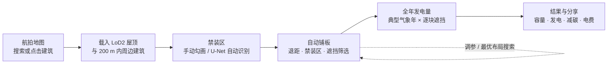
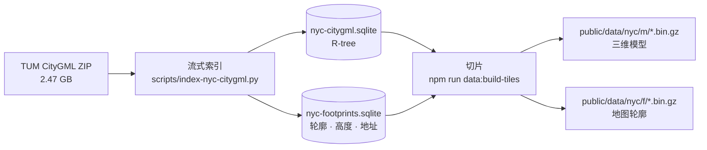
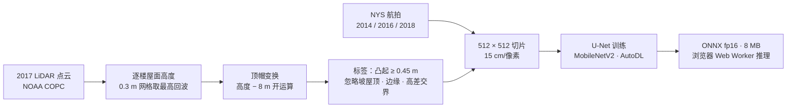

# NYC Solar Studio

在纽约任意一栋楼的真实三维屋顶上做概念级光伏设计：从航拍地图选楼，用 AI 自动圈出屋顶设备，一键铺板，计入周边建筑遮挡算出全年发电量。纯静态网站，部署在 GitHub Pages 上，不需要服务器或任何 API Key。

**[功能](#功能) · [数据来源](#数据来源) · [方法](#方法) · [本地运行](#本地运行) · [局限](#局限)**

[](docs/demo.mp4)

> 演示：从全市地图搜索布鲁克林的 P.S. 321 小学 → 进入 LoD2 三维屋顶 → 打开航拍底图和 2D 俯视 → U-Net 自动识别禁装区 → 生成阵列 → 冬至下午的阴影 → 逐块年发电 → 结果。点击动画查看 60 fps 高清视频。

> [!NOTE]
> 结果用于方案比较和早期沟通，不能代替现场勘测、结构复核和施工设计。建筑模型和航拍反映 2014 年前后的状态，建筑可能已改建。

## 功能

- **地图选楼**：纽约州 2014 年正射航拍，放大后显示约 108 万栋建筑的轮廓；支持地址搜索，点在街道上会自动吸附到 25 m 内最近的建筑。
- **真实三维屋顶**：每栋楼使用 NYC / TUM LoD2 CityGML 模型，保留真实的屋面、坡度、多层屋顶和墙面；200 m 内的周边建筑一起载入，参与遮挡计算。
- **禁装区**：
  - 用钢笔式工具逐点勾画楼梯间、设备、检修口或通道；
  - 也可以点「自动识别」，由浏览器里的 U-Net 模型从航拍中找出屋顶障碍物并框成禁装区；
  - 每一处都能在列表里单独删除或拖动锚点修改，2D 俯视方便对照底图描边。
- **自动铺板**：避开禁装区、边缘退距、墙面和遮挡严重的位置，在平屋顶上按支架排布，在坡屋顶上顺坡平铺；改倾角、行距、朝向等参数会实时重排。
- **日照与阴影**：任意日期、时刻的太阳位置和三维阴影，可连续播放一天的变化。
- **全年发电量**：基于纽约典型气象年逐块估算，计入建筑自遮挡、排间遮挡和周边建筑遮挡；可以按年发电表现给每块组件着色。
- **最优布局搜索**：比较 42 种倾角和行距组合，按"总发电量最多"或"兼顾单板效率"排序，一键应用。
- **方案对比与分享**：A/B 方案比较；草稿自动保存在浏览器里；复制链接即可分享完整方案。
- **导览**：首次访问时用 P.S. 321 演示完整流程，之后可以随时从右上角「?」打开。
- **中英文界面**。

## 截图

| | |
|---|---|
| [](docs/screenshots/readme-map.jpg)<br>**地图选楼**：2014 年航拍上点击或搜索建筑，蓝色为选中轮廓 | [](docs/screenshots/readme-model.jpg)<br>**LoD2 三维屋顶**：选中建筑和 200 m 内的周边建筑（半透明） |
| [](docs/screenshots/readme-zones.jpg)<br>**自动识别禁装区**：2D 俯视加航拍底图，红框为 U-Net 识别出的设备和楼梯间 | [](docs/screenshots/readme-shadows.jpg)<br>**阵列与阴影**：415 块组件，冬至下午周边建筑投下的长影 |
| [](docs/screenshots/readme-yield.jpg)<br>**逐块年发电表现**：以理想无遮挡组件为参考着色，靠近楼梯间和女儿墙的组件偏低 | [](docs/screenshots/readme-results.jpg)<br>**结果**：装机容量、年发电量、减碳和节省电费，附计算口径说明 |

## 整体流程



所有计算都在浏览器里完成：建筑数据是仓库里的静态瓦片，航拍和地址搜索是免费、无需 Key 的公共服务，AI 模型以 ONNX 文件形式随网站发布。

## 数据来源

| 数据 | 提供方 | 年份 | 在项目里的用途 |
|---|---|---|---|
| [纽约 LoD2 三维建筑模型（CityGML）](https://www.asg.ed.tum.de/gis/projekte/new-york-city-3d/) | 纽约市 DoITT 3D Building Model，经慕尼黑工业大学（TUM）整理为 LoD2 | 2014 年测绘，2017 年发布 | 屋顶、墙面、底面几何；地图轮廓；周边遮挡 |
| [纽约州正射航拍](https://orthos.its.ny.gov/arcgis/rest/services/wms) | NYS ITS Geospatial Services | 2014（网站）；2014/2016/2018（训练） | 地图底图、3D 底图、障碍物识别的输入 |
| [2017 纽约地形测深 LiDAR](https://noaa-nos-coastal-lidar-pds.s3.amazonaws.com/laz/geoid18/9306/index.html) | NYC / NOAA Office for Coastal Management | 2017 | 仅用于离线生成训练标签，网站运行时不需要 |
| [NYC GeoSearch](https://geosearch.planninglabs.nyc/) | NYC Planning Labs | 实时 | 地址搜索 |
| [PVGIS-ERA5 典型气象年](https://joint-research-centre.ec.europa.eu/photovoltaic-geographical-information-system-pvgis_en) | 欧盟联合研究中心（JRC） | 2005–2023 | 逐月逐小时的辐照和气温（`src/lib/solar/nyc-climate.ts`） |
| [eGRID2023](https://www.epa.gov/egrid) | 美国环保署（EPA） | 2023 | NYCW 子区域电网排放因子 974.66 lb/MWh ≈ 442 kg CO₂/MWh |
| [RECS 2020](https://www.eia.gov/consumption/residential/) | 美国能源信息署（EIA） | 2020 | 冰箱年耗电 542 kWh，用于结果页的直观换算 |
| ImageNet 预训练权重 | segmentation_models_pytorch / timm | — | U-Net 编码器的初始化 |

**默认参数**：组件 1.045 × 1.879 m、400 W；朝南，支架倾角 10°，边缘退距 1.2 m，行距 0.8 m；电价 0.338 美元/kWh（界面可改，正式使用前请按 Con Edison 实际费率核对）。

## 方法

### 1. 建筑模型与静态瓦片



- 保留 CityGML 原有的 RoofSurface、WallSurface、GroundSurface，只做坐标转换（州平面 EPSG:32118 → 场景坐标）和多边形三角化；保留 gml ID、NYC BIN 和原高度。
- 全市约 108 万栋建筑按 0.003° × 0.0025°（约 250 m）的网格切成 gzip 瓦片，共约 350 MB：
  - 模型瓦片：州平面坐标，厘米精度，以建筑最小坐标为基准做整数偏移存储；
  - 轮廓瓦片：经纬度 × 10⁷ 的差分整数，约 1 cm 精度；
  - 格式见 `src/lib/nyc/tile-format.ts`。
- 浏览器用 `DecompressionStream` 解压，只下载点击处附近的几块瓦片：
  - 先在 ±1 格内做点在面内判断，没有命中就吸附到 25 m 内最近的建筑；
  - 在 ±2 格内收集 200 m 内的周边建筑；
  - 只保留按距离计算、高出屋面超过 tan(3°) 的建筑，因为太阳高度低于 3° 时的遮挡可以忽略。

### 2. 日照、阴影与遮挡

- **太阳位置**用 SunCalc 计算。
- **全年发电量的采样**：取每个月 21 日的逐小时太阳位置，只保留太阳在地平线以上、且有辐照的时刻，权重来自 PVGIS 典型气象年。
- **遮挡判断**：从组件中心向太阳方向发射射线，碰到的物体包括本楼屋面、本楼墙面和周边建筑。
  - 三角面用包围体层次结构（BVH）加速；
  - 每 1.5 m 网格缓存一次可见性。
- **耗时计算放在 Web Worker 里**，界面不会卡：一栋 11,000 块组件的大屋顶，编辑一次约 0.1 秒。

### 3. 自动铺板

每个平面屋面单独处理：

1. 在屋面局部坐标系里建立 0.2 m 栅格，用距离变换扣除边缘退距；禁装区按 2 m 高差容差投影到对应屋面，再扣除同样的退距。
2. 支架行与建筑主轴对齐，在 36 种网格偏移里选能放下最多组件的一种。
3. 对候选位置做全年直射光照评分；低于最佳位置 80% 的位置舍弃，参照常用的 80% TSRF 规则。
4. 坡度小于 8° 的屋面按支架倾角排布，并留出排间距；坡屋顶则顺坡平铺。
5. 检查组件不穿墙、不进入周边建筑、不和已有组件重叠。手动放置的组件也走同一套检查。

### 4. 发电量模型

逐块组件、逐月、逐小时计算：

- **组件平面辐照** = 直射（计入上面的遮挡） + 各向同性散射 × 天空可视比例 + 地面反射（反照率 0.2）；
- **损失**依次计入：ASHRAE 入射角损失、电池温度修正、PVWatts 默认 14% 系统损失、96% 逆变器效率；
- **对照**：无遮挡、最佳倾角的组件约 1,360 kWh/kWp，比 NREL PVWatts 对纽约的估算高几个百分点，原因是 ERA5 的日照略偏高；结果页给出了按 PVWatts 口径换算的区间。

### 5. 最优布局搜索

- **搜索范围**：在 Web Worker 里遍历 7 种支架倾角（0°–30°）× 6 种行距（0.3–2 m），共 42 种组合，其他参数保持用户的设置。
- **复用计算**：同一栋楼的太阳可见性缓存在不同倾角之间共享，中城一栋裙楼的搜索从 92 秒降到约 13 秒。
- **两种排序目标**：
  - 总发电量最多；
  - 平衡：单板效率不低于 90% 的组合里，选总发电量最多的。
- 列出前 3 名，点一下即可应用。

### 6. 屋顶障碍物识别（U-Net）

LoD2 模型里没有屋顶上的小设备，所以用一个小型 U-Net 从航拍中识别它们。难点是没有现成的标注，**训练标签用 2017 年 LiDAR 自动生成**：LiDAR 只用来"教"模型，部署后的网站只需要航拍图。



**生成标签**（`ml/nyc_roofs.py`）：

- 在每栋楼的脚注内，取每 0.3 m 网格里最高的 LiDAR 回波，得到屋顶表面高度。
- 对每栋楼单独做 8 m 窗口的形态学开运算，相当于把宽度小于 8 m 的凸起"削平"，得到没有设备的光秃屋面。
- 两者相减，凸起 0.45 m 以上的就是障碍物：设备、楼梯间、水箱、排风口等。
- 以下区域标为"忽略"，不参与训练：
  - 坡屋顶（屋脊会被误当成凸起）；
  - 屋顶边缘 0.6 m 以内；
  - 不同高度屋面的交界处；
  - 面积超过 45 m² 的整片凸起，通常是更高一层的屋面而不是设备。


<sub>P.S. 321：左为 2014 年航拍；中为 LiDAR 自动标签（红色为障碍物，暗色为不参与训练）；右为 U-Net 在 2014 年航拍上的预测。三个楼梯间和十几个排风口都被找到，其中一条长条是屋面高差处的阴影，属于误报。</sub>

**数据集**（`ml/build_dataset.py`）：在全市随机抽取 60 块 LiDAR（每块约 770 m 见方），生成 1,168 张 512 × 512 切片，每张配 2014、2016、2018 三个年份的航拍。训练、验证、测试集按 LiDAR 块划分（993 / 86 / 89 张），相邻区域不会同时出现在训练集和测试集里；P.S. 321 固定放在测试集。


<sub>训练样本：红色为 LiDAR 标出的障碍物，暗色为不参与训练的区域。三个年份的影像对应同一份标签，让模型适应不同的拍摄季节和光照。</sub>

**训练**（`ml/train/`，在 AutoDL 的 RTX 4090D 上训练 60 轮，约 7 分钟）：

- U-Net 加 ImageNet 预训练的 MobileNetV2 编码器，解码器做了精简，导出后的 fp16 ONNX 只有 8 MB；
- 损失函数为 BCE（正样本权重 3）加 Dice，只在有标签的像素上计算；
- 数据增强：随机裁剪 384、旋转、翻转、亮度、对比度、色调和 gamma；
- 优化器 AdamW，配合预热和余弦退火学习率。


**成绩**（阈值 0.4，在验证集上选定）：

| | 像素 F1 | 像素 IoU | 物体检出率 | 物体准确率 | 障碍物数 |
|---|---|---|---|---|---|
| 验证集 | 0.41 | 0.26 | 0.49 | 0.61 | 1,671 |
| 测试集 | 0.43 | 0.28 | 0.49 | 0.60 | 1,425 |

- **物体检出率**：LiDAR 标出的障碍物（≥ 0.3 m²）里，被模型碰到的比例。
- **物体准确率**：模型框出的区块里，确实有障碍物的比例。
- **这两个数字低估了实际效果**：
  - 漏检的多是排屋屋顶上只有几个像素的小排风口，在航拍上本来就看不见；
  - 一部分"误报"其实是平贴在屋面上的天窗，LiDAR 量不出高度差所以没标，但模型认出来了。


<sub>测试集（训练时没见过的街区）：红色为 LiDAR 障碍物，青色轮廓为模型预测。</sub>

标签生成、模型和训练的代码，以及训练曲线、阈值扫描和三栋真实建筑上的预测，都汇总在 [`ml/unet-results.ipynb`](ml/unet-results.ipynb) 里，可以直接在 GitHub 上查看。

**在网站里**（`src/lib/design/obstacle.worker.ts`、`detect-obstacles.ts`）：

1. 用户点击「自动识别」时，才加载 ONNX Runtime Web（WebAssembly 版，约 15 MB）和模型。
2. 从 3D 底图里裁出这栋楼平屋面的范围，重采样到 15 cm/像素，切成重叠的 512 像素块，在 Web Worker 里推理。
3. 概率不低于 0.4 的像素经过形态学清理，按连通区域分组，再用旋转卡壳法求最小面积外接矩形，外扩 0.15 m 后成为禁装区。
4. 首次识别约 3 秒。模型加载失败时，改用颜色异常算法：按屋面颜色的中位数和中位绝对偏差（MAD）找出异常像素。

### 7. 结果

- **装机容量** = 组件数 × 400 W。
- **年发电量**：按第 4 节逐块求和。
- **减碳** = 年发电量 × 442 kg CO₂/MWh。
- **节省电费** = 年发电量 × 电价。
- 结果页会说明：是否扣除了禁装区、年发电量使用典型气象年（和时间条显示的日期无关）、PVWatts 口径的换算区间，以及组件和损失假设。

## 技术栈

- **网页**：Next.js（静态导出）、React、TypeScript、Tailwind CSS、MapLibre GL、Three.js / React Three Fiber、SunCalc、Proj4、ONNX Runtime Web、Vitest。
- **数据处理**：Node SQLite、fast-xml-parser、Python（numpy、scipy、laspy、pyproj、Pillow）。
- **训练**：PyTorch、segmentation_models_pytorch、ONNX。
- **演示录制**：Playwright、FFmpeg。

## 本地运行

需要 Node.js 22.13+（已验证 Node 24）。仓库已包含建筑瓦片和模型：

```bash
npm install
```

```bash
npm run dev
```

打开 http://localhost:3000 。`npm run dev` 和 `npm run build` 会先把 ONNX Runtime 的 WebAssembly 复制到 `public/ort`。

检查：

```bash
npm test
```

```bash
npm run lint
```

## 部署到 GitHub Pages

1. 把仓库推送到 GitHub，包括 `public/data/nyc`（约 350 MB）和 `public/models`。
2. 在仓库 Settings → Pages 里，把 Source 选为 **GitHub Actions**。
3. 推送到 `main`，或手动运行 "Deploy to GitHub Pages" 工作流（`.github/workflows/pages.yml`）。它会以仓库路径作为 `NEXT_PUBLIC_BASE_PATH` 静态导出 `out/` 并发布。

本地预览静态导出：先运行 `npm run build`，再用任意静态服务器打开 `out/`。

## 重新生成数据和模型

**建筑瓦片**：把 [官方 CityGML ZIP](https://www.3dcitydb.net/3dcitydb/fileadmin/public/datasets/NYC/NYC_buildings_CityGML_LoD2/NYC_Buildings_LoD2_CityGML.zip)（约 2.47 GB）放到 `data/raw/nyc-tum/`，然后运行：

```bash
python scripts/index-nyc-citygml.py --archive data/raw/nyc-tum/NYC_Buildings_LoD2_CityGML.zip --output data/processed/nyc-citygml.sqlite --sevenzip node_modules/7zip-bin/win/x64/7za.exe
```

```bash
npm run data:build-footprints
```

```bash
npm run data:build-tiles
```

- `data:build-tiles` 单进程约 2 小时，可以传入经纬度范围（`west,south,east,north`）分区并行运行；已写出的瓦片会跳过；最后不带范围再运行一次，生成 `index.json`。
- 研究区边界（地图上的蓝线）由 `npm run data:build-coverage` 生成。

**障碍物模型**：需要 Python 3.10+，会下载约 4 GB LiDAR。

```bash
python -m venv ml/.venv
```

```bash
ml/.venv/Scripts/python -m pip install numpy scipy "laspy[lazrs]" pyproj pillow
```

```bash
ml/.venv/Scripts/python ml/build_dataset.py --tiles 60 --out data/ml/dataset
```

```bash
ml/.venv/Scripts/python ml/package_autodl.py
```

把 `data/ml/autodl-package.zip` 上传到 GPU 服务器，按包里的 `train/README.md` 训练、评估、导出。然后：
- 把 `model.fp16.onnx` 放到 `public/models/roof-obstacles.onnx`；
- 阈值在 `src/lib/design/obstacle-model.ts` 里修改；
- 配图由 `ml/make_figures.py` 生成；[`ml/unet-results.ipynb`](ml/unet-results.ipynb) 汇总了标签生成和训练代码、训练曲线、测试成绩和在真实建筑上的预测（在本地运行，不重新训练）。

## 录制演示动画

需要 FFmpeg、Microsoft Edge，以及装有 Pillow 的 Python。先启动本地站点（推荐用静态导出），再运行：

```bash
npm run demo:record -- http://localhost:8090/solar-3d-web/
```

```bash
npm run readme:screenshots
```

- `demo:record` 按 [分镜](docs/demo-storyboard.md) 驱动真实界面，用 Chrome DevTools 截屏流逐帧采集，生成：
  - `docs/demo.mp4`：60 fps，1440 × 900；
  - `docs/demo.webp`：20 fps 动态 WebP，800 px 宽，用于 README。
- `readme:screenshots` 从视频中抽取截图。
- 默认录制英文界面，设置 `DEMO_LANG=zh` 录制中文界面；原始帧约 1 GB，可用 `DEMO_TMP` 指定存放目录。

## 局限

- **建筑模型和航拍的时间**：都是 2014 年前后的状态，之后新建、拆除或加建的建筑对不上。
- **航拍偏移**：高楼在航拍上有倾斜，屋顶影像和自动识别的框可能偏离几米。
- **遮挡没有计入的东西**：树木、天气、积雪和屋顶上的小设备都没有算进遮挡；自动识别出的禁装区只用来避让，不参与阴影计算。
- **自动识别需要核对**：会漏掉和屋面颜色相近或 2014 年后才加装的设备，偶尔也会把高差处的阴影线误报成障碍物。
- **发电量是估算**：用于方案比较，未考虑组件串并联、逆变器选型、屋面荷载和消防通道等工程约束。
- **电价是默认值**：0.338 美元/kWh 只是示例，需要按实际电费单修改。

## 来源与致谢

- Building models: NYC Open Data / DoITT 3D Building Model; LoD2 CityGML by the Chair of Geoinformatics, Technical University of Munich.
- Imagery © NYS ITS Geospatial Services. LiDAR: 2017 New York City Topobathymetric LiDAR, NYC / NOAA Office for Coastal Management.
- Address search: NYC Planning Labs GeoSearch. Climate: PVGIS-ERA5 TMY, European Commission JRC. Grid factor: EPA eGRID2023.

公开使用时请保留以上来源说明，并遵守各数据的使用条款。
